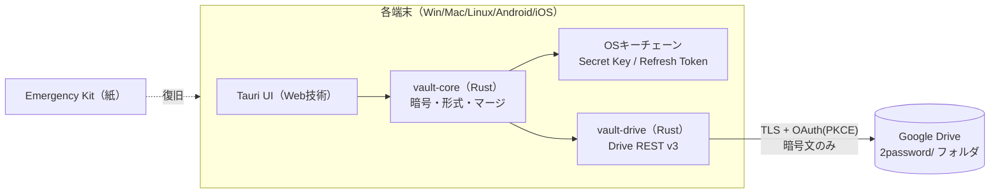

# 2password：1Passwordの安全設計を自分で再現する（設計書＋実装プロンプト）

> 対象：Google Drive を「暗号文だけを置くサーバー」として使い、Windows / macOS / Linux / Android / iPhone で動くパスワード保管庫を、監査済みOSS暗号ライブラリと Rust で自作する。
> 作成日：2026-11-11。クレートのバージョンは同日に crates.io API で確認した最新安定版。

---

## 0. 結論（最も簡単で安全な構成）

| 決定事項 | 採用 | 理由 |
|---|---|---|
| 言語・構成 | Rust ワークスペース（`vault-core` / `vault-drive` / `vault-cli` / `app`） | 暗号処理を I/O から切り離し、監査とテストの範囲を小さくする |
| クロスプラットフォームUI | **Tauri 2**（1つのコードで Win/Mac/Linux/Android/iOS） | Rust コアをそのまま全OSで使える。Flutter/Kotlin/Swift を個別に書かずに済む |
| 暗号プリミティブ | **RustCrypto**（argon2 / chacha20poly1305 / hkdf / sha2）| 純Rust、広く使われ監査実績あり。暗号アルゴリズムは**自作しない** |
| パスワードの引き伸ばし | **Argon2id**（1Password は PBKDF2） | メモリハードで GPU 総当たりに強い。パラメータはファイルに保存して将来引き上げ可能 |
| 2つの秘密 | **アカウントパスワード＋Secret Key（128bit）** の Two-Secret Key Derivation | 1Password の核心。Drive の暗号文が盗まれても総当たりが成立しない |
| データ暗号化 | **XChaCha20-Poly1305**（AEAD、192bit ランダム nonce） | ランダム nonce の衝突を心配せずに済む。AES-GCM の nonce 管理より事故が起きにくい |
| 鍵の階層 | AUK → Vault Key → 保管庫ファイル | パスワード変更時に保管庫全体を再暗号化しなくてよい |
| サーバー | **Google Drive API v3、スコープ `drive.file`** | アプリが作ったファイルにしか触れない最小権限。Drive側は暗号文しか見ない |
| ログイン | **Google OAuth 2.0 + PKCE**（SRP の代わり） | 自前サーバーがないので SRP は不要。機密性は E2EE が担い、アクセス制御は Google が担う |
| 端末内の秘密 | Secret Key と OAuth リフレッシュトークンを **OS のキーチェーン**へ | Windows 資格情報マネージャー / macOS・iOS Keychain / Linux Secret Service / Android Keystore |
| 同期方式 | **保管庫を1ファイル**にまとめ、`headRevisionId` で競合検知 → マージ | 最も単純。項目数やタイトルもファイル名から漏れない |
| ロールバック対策 | 暗号化ヘッダ内の単調増加カウンタを端末が記憶 | Drive が古い版を返しても検知できる |

**MVP で作らないもの**：ブラウザ拡張の自動入力、iOS/Android の OS 自動入力サービス、他人との共有、生体認証での解除。どれも攻撃面が大きく、まず「暗号文を Drive に置いて全端末で読める」核を固めてから段階的に足す（§9）。

---

## 1. 1Password の仕組みと、2password での置き換え

| 1Password の要素 | 役割 | 2password での実現 |
|---|---|---|
| 端末上で暗号化（E2EE） | サーバーに平文を渡さない | `vault-core` が端末内で暗号化し、Drive には `.2pw` 暗号文だけを置く |
| アカウントパスワード | 利用者が記憶する秘密 | 同じ。NFKC 正規化してから Argon2id へ |
| Secret Key（128bit、`A3-`…） | サーバー流出時の総当たりを無効化 | `2P1-` で始まる 128bit 乱数。端末のキーチェーンと Emergency Kit にだけ存在 |
| PBKDF2-HMAC-SHA256 | パスワード推測のコストを上げる | Argon2id（m=64MiB, t=3, p=1 を下限。モバイルでも1秒前後） |
| 2SKD（PBKDF2 結果と HKDF(Secret Key) の XOR） | 2つの秘密を合成して AUK を作る | 同じ構造：`AUK = Argon2id(pw) XOR HKDF(SecretKey)` |
| 鍵階層（AUK → 個人鍵ペア → Vault Key → Item） | 共有と鍵変更を容易に | MVP は AUK → Vault Key → 保管庫。共有は Phase 4 で X25519/HPKE を追加 |
| AES-256-GCM | アイテム暗号化 | XChaCha20-Poly1305（同等の安全性で nonce 事故に強い） |
| SRP | パスワードを送らずに認証 | Google OAuth + PKCE。**Drive に届くのは暗号文のみ**なので、Google アカウントが乗っ取られても中身は読めない |
| TLS + SRP セッション鍵の二重暗号化 | 通信路の多重防御 | TLS（rustls）＋そもそも暗号文しか送らない E2EE |
| 自動ロック・生体認証 | 端末側の保護 | 自動ロック（既定5分）、クリップボード30秒消去、メモリの zeroize。生体認証は Phase 3 |
| Emergency Kit | 復旧手段 | 初期化時に Secret Key・アカウントID・QR を含む PDF/印刷用 HTML を生成 |
| Watchtower | 漏えい・使い回し検知 | Phase 5（HIBP の k-匿名性 API。SHA-1 先頭5文字だけを送る） |

### 事前調査の補正メモ

- バグ報奨金のプラットフォームは、2つの資料で HackerOne / Bugcrowd と食い違っている。筆者の知識では **Bugcrowd**。公式の Security Assessments ページで確認すること。
- PBKDF2 の反復回数（「約65万回」）は改定されることがある。最新版の 1Password Security Design ホワイトペーパーで確認すること。
- 「メタデータもすべて暗号化」は、**保管庫内の**タイトル・URL・タグについて正しい。登録メールアドレス、課金情報、IP アドレスなどは運営側が扱う。2password でも同様に、Google は「ファイル名・サイズ・更新日時・アクセス元IP」を見られる（§6）。

---

## 2. 全体アーキテクチャ



### ワークスペース構成

```
2password/
├─ Cargo.toml                # workspace, [workspace.dependencies] でバージョン一元管理
├─ deny.toml                 # cargo-deny（ライセンス・脆弱性・重複依存）
├─ crates/
│  ├─ vault-core/            # 純粋ロジック。I/O・ネットワーク・unsafe 禁止
│  │   ├─ kdf.rs             # NFKC, Argon2id, HKDF, 2SKD
│  │   ├─ secret_key.rs      # 生成・表示形式・パース
│  │   ├─ envelope.rs        # .2pw バイナリ形式（AEAD + AAD）
│  │   ├─ account.rs         # account.2pw（KDFパラメータ・ラップ済み Vault Key）
│  │   ├─ vault.rs           # Item モデル、マージ、カウンタ
│  │   └─ lib.rs
│  ├─ vault-drive/           # OAuth(PKCE)・Drive v3 アップロード/ダウンロード/リビジョン確認
│  ├─ vault-cli/             # ハンズオン用 CLI（デスクトップ）
│  └─ vault-store/           # キーチェーン抽象化（デスクトップ: keyring / モバイル: プラグイン）
└─ app/                      # Tauri 2 アプリ（src-tauri は vault-core / vault-drive を呼ぶだけ）
```

---

## 3. 暗号設計（仕様）

### 3.1 秘密と鍵の一覧

| 名前 | 生成方法 | 保存場所 | Drive に置くか |
|---|---|---|---|
| アカウントパスワード `P` | 利用者が決める（zxcvbn スコア3以上を要求） | 利用者の記憶のみ | 置かない |
| Secret Key `SK` | OS の CSPRNG で 16 バイト | OS キーチェーン、Emergency Kit | **置かない** |
| アカウントID `AID` | 乱数 6 文字（Crockford Base32） | account.2pw、SK の表示にも含める | 置く（秘密ではない） |
| salt | 乱数 16 バイト | account.2pw | 置く |
| AUK（Account Unlock Key） | 2SKD で導出 | **メモリ上のみ**（zeroize） | 置かない |
| Vault Key `VK` | 乱数 32 バイト | AUK でラップして account.2pw に | ラップ済みのみ置く |

### 3.2 Secret Key の形式

```
2P1-ABC123-XXXXX-XXXXX-XXXXX-XXXXX-XXXXXX
 │    │      └─ 128bit を Crockford Base32 で26文字（区切りは表示用）
 │    └─ アカウントID（6文字）
 └─ 形式バージョン
```

- 入力時は大文字化し、`-`・空白・紛らわしい文字（O→0, I/L→1）を正規化する。
- 128bit のエントロピーは**この 26 文字部分だけ**に入っている。

### 3.3 Two-Secret Key Derivation（2SKD）

```
P'      = NFKC(P)                                   # 日本語入力の揺れ対策（全角/半角・合成文字）
k_pw    = Argon2id(P', salt = salt || AID, m=65536 KiB, t=3, p=1, out=32)
k_sk    = HKDF-SHA256(ikm = SK, salt = AID, info = "2password/secret-key/v1", L=32)
AUK     = k_pw XOR k_sk
```

- Drive の中身をすべて盗んだ攻撃者でも、`SK` の 2^128 通りを同時に当てない限り `P` の総当たりを始められない。
- KDF パラメータは account.2pw に保存するが、**クライアントは下限（m≥64MiB, t≥3）を強制**する。攻撃者がパラメータを書き換えて弱めさせることを防ぐため。
- 中間値（`P'`, `k_pw`, `k_sk`, `AUK`）は `zeroize` / `secrecy` で使用後すぐ消す。

### 3.4 暗号文フォーマット `.2pw`（共通エンベロープ）

```
magic   "2PW\x01"            4 bytes
hlen    u32 little-endian     4 bytes
header  JSON (UTF-8)          hlen bytes   ← AEAD の AAD（改ざん検知対象）
nonce   24 bytes              XChaCha20 用ランダム値
ct+tag  ciphertext || 16-byte Poly1305 tag
```

header の例（平文だが改ざんは検知される）：

```json
{ "v": 1, "kind": "vault", "aid": "ABC123", "vault_id": "9f1c…", "counter": 42, "pad": 4096 }
```

- `counter` は保存のたびに +1。端末は「見たことのある最大値」をローカルに記憶し、それより小さい版を受け取ったら **ロールバック攻撃として拒否**する。
- 平文は 4KiB 単位でパディングし、アイテム数が容量から推測されにくいようにする。
- AAD に `aid` と `vault_id` を含めるので、別アカウント・別保管庫の暗号文に差し替えられても復号に失敗する。

### 3.5 account.2pw（Drive に置く「鍵の箱」）

```json
{
  "v": 1,
  "aid": "ABC123",
  "kdf": { "alg": "argon2id", "m_kib": 65536, "t": 3, "p": 1, "salt": "base64…" },
  "wrapped_vault_key": "base64(.2pw エンベロープ, kind=vault-key, 鍵=AUK)",
  "created_at": "2026-11-11T00:00:00Z"
}
```

- `wrapped_vault_key` の AAD には `aid` と `kdf` 全体を含める。
- パスワード変更：新しい salt で AUK' を作り、VK を包み直すだけ。保管庫本体の再暗号化は不要。
- Secret Key の再発行：同様に VK を包み直す（古い Emergency Kit は無効になる）。

### 3.6 保管庫の平文（vault.2pw の中身）

```json
{
  "items": [
    { "id": "uuid", "kind": "login", "title": "○○銀行", "urls": ["https://bank.example"],
      "username": "…", "password": "…", "totp": null, "notes": "",
      "updated_at": "2026-11-11T09:00:00Z", "deleted": false }
  ]
}
```

- 削除は `deleted: true` の墓石で表し、マージ時に復活しないようにする。
- マージ規則：同じ `id` は `updated_at` が新しい方を採用（同時刻ならデバイスIDの辞書順）。

### 3.7 同期アルゴリズム

```
save():
  1. meta = drive.get(vault_file, fields=headRevisionId)
  2. if meta.headRevisionId != local.last_seen_revision:
        remote = decrypt(drive.download())        # counter チェック込み
        merged = merge(local, remote)
     else merged = local
  3. merged.counter = max(local.counter, remote.counter) + 1
  4. drive.update(vault_file, encrypt(merged))
  5. 保存後に headRevisionId を再取得し、2 の後に別端末が書き込んでいたら 1 からやり直す（最大3回）
```

個人や家族程度の利用ならこれで十分。高頻度の同時編集が必要なら、アイテム単位ファイルに分割する（Phase 4）。

---

## 4. Google Drive 連携

| 項目 | 設定 |
|---|---|
| API | Google Drive API v3（REST を `reqwest` + `rustls` で直接呼ぶ。生成クライアントは依存が重いので使わない） |
| スコープ | `https://www.googleapis.com/auth/drive.file` のみ（アプリが作成・開いたファイルだけ） |
| OAuth クライアント | デスクトップ：「デスクトップアプリ」型＋ループバック（`http://127.0.0.1:<random port>`）＋PKCE(S256)<br/>Android/iOS：各プラットフォーム用クライアント＋カスタム URL スキーム（`tauri-plugin-deep-link`）＋PKCE |
| ブラウザ | 必ず**システムブラウザ**で認可画面を開く（`tauri-plugin-opener`）。WebView 埋め込みは Google が禁止しており、フィッシング耐性も下がる |
| トークン | アクセストークンはメモリのみ。リフレッシュトークンは OS キーチェーンへ |
| ファイル配置 | `2password/account.2pw`、`2password/vault-<vault_id>.2pw`（ファイル名に意味のある語を入れない） |
| `state` / `nonce` | CSRF 対策として毎回乱数を生成し照合 |

Google アカウント自体は**パスキーか2段階認証**で守る。Google アカウントが乗っ取られても暗号文しか取れないが、ファイルの削除やロールバックは可能になるため、**可用性**を守るために重要。ローカルにも最新の暗号文を残し、Drive が消されても復元できるようにする。

---

## 5. 端末側の保護

| 対策 | 実装 |
|---|---|
| メモリ上の秘密の消去 | `secrecy::SecretBox` / `zeroize::Zeroizing`。`Debug` 出力で秘密を表示しない |
| 自動ロック | 無操作5分・スリープ・画面ロックで AUK と VK を破棄 |
| クリップボード | コピー後30秒で消去（`tauri-plugin-clipboard-manager`）。消去前に内容が自分のコピーと同じか確認 |
| ログ | 秘密・平文・トークンをログに出さない。`tracing` のフィールドに型で禁止する |
| Secret Key の保存 | OS キーチェーン。iOS/macOS は `kSecAttrAccessibleWhenUnlockedThisDeviceOnly` 相当でバックアップ対象外に |
| 画面 | モバイルでスクリーンショット禁止（Android `FLAG_SECURE`、iOS はアプリ切替時に目隠し） |
| unsafe | `vault-core` は `#![forbid(unsafe_code)]` |

---

## 6. 脅威モデル（何を守り、何を守らないか）

| 想定される事態 | 2password の防御 | 限界 |
|---|---|---|
| Google Drive の中身が丸ごと盗まれる | Secret Key がないため総当たり不能 | ファイル名・サイズ・更新時刻は見える |
| Google アカウントが乗っ取られる | 暗号文しか取れない。改ざんは AEAD で検知 | ファイル削除・古い版への差し戻しは可能 → ローカル控え＋カウンタ |
| 通信の盗聴・中間者 | TLS ＋ 暗号文のみ送信 | — |
| アカウントパスワードだけ漏れる | Secret Key もないと開けない | 端末も奪われると Secret Key はキーチェーンにある |
| 端末の盗難（ロック中） | OS ログイン＋キーチェーン＋アカウントパスワード | 弱いパスワードは端末上で総当たりされうる → 強いパスフレーズ必須 |
| 端末のマルウェア・キーロガー | **守れない**（解除中は平文がメモリにある） | OS 更新・ディスク暗号化・不要なリモート操作の停止 |
| 偽サイトへの入力 | MVP は自動入力なし＝人が URL を確認 | Phase 6 の拡張機能でドメイン照合を実装 |
| AI エージェントへの露出 | 保管庫を AI に接続しない | 銀行ログインと送金承認は人が行う |
| 自作コードのバグ | 暗号は監査済みクレートのみ、KAT・改ざんテスト、cargo-audit/deny | **第三者監査は受けていない**。重要資産での本番利用は自己責任 |
| 依存クレートのサプライチェーン | Cargo.lock 固定、cargo-audit、cargo-deny、依存最小化 | 完全には防げない |
| Secret Key とパスワードの両方を失う | Emergency Kit | 両方失えば**誰にも復旧できない**（設計上の裏返し） |

---

## 7. 使用する OSS（2026-11-11 crates.io で確認）

> RustCrypto 系は 2025〜2026 年にメジャー更新があり（argon2 0.6 / chacha20poly1305 0.11 / hkdf 0.13 / sha2 0.11 / rand_core 0.10）、旧版と API が異なる。**実装前に docs.rs で該当バージョンの API を必ず確認**し、RustCrypto 系は同じ世代で揃えること。

| 用途 | クレート | バージョン |
|---|---|---|
| パスワードKDF | `argon2` | 0.6.0 |
| AEAD | `chacha20poly1305`（XChaCha20Poly1305） | 0.11.0 |
| HKDF / SHA-256 | `hkdf` / `sha2` | 0.13.0 / 0.11.1 |
| 乱数 | `getrandom`（OS CSPRNG） / `rand_core` | 0.4.3 / 0.10.1 |
| 秘密の消去 | `zeroize` / `secrecy` | 1.9.1 / 0.10.3 |
| 定数時間比較 | `subtle` | 2.6.1 |
| 文字列正規化 | `unicode-normalization` | 最新 0.1.x |
| パスワード強度 | `zxcvbn` | 最新安定版 |
| シリアライズ | `serde` / `serde_json` / `base64` | 1.x / 1.0.154 / 0.23.1 |
| エラー | `thiserror` | 2.0.21 |
| ID | `uuid`（v4） | 1.29.2 |
| HTTP / TLS | `reqwest`（`rustls` 機能、OpenSSL 不使用） / `rustls` | 0.13.5 / 0.23.46 |
| OAuth | `oauth2`（PKCE） | 5.0.0 |
| 非同期 | `tokio` | 1.54.1 |
| キーチェーン（デスクトップ・iOS） | `keyring`（v4 は `keyring-core` ＋ストア構成） | 4.2.0 |
| アプリ | `tauri` | 2.12.5 |
| Tauri プラグイン | `tauri-plugin-deep-link` / `-opener` / `-clipboard-manager` / `-biometric`(Phase 3) | 2.6.3 / 2.7.3 / 2.5.0 / 2.5.0 |
| 共有（Phase 4） | `hpke`（X25519-HKDF-SHA256 + ChaCha20Poly1305） | 0.15.1 |
| 監査ツール | `cargo-audit` / `cargo-deny` | 0.23.0 / 0.20.2 |

Android のキーチェーンは `keyring` v4 のストア対応状況を確認し、未対応なら **Android Keystore を使う小さな Kotlin 製 Tauri プラグイン**を書く（Secret Key を Keystore の AES 鍵で包んで保存）。

---

## 8. ハンズオンの進め方（`2password-handson.html` のスライドと対応）

| Step | 内容 | 完了条件 |
|---|---|---|
| 1 | ワークスペース作成、`deny.toml`、CI に `cargo audit` | `cargo deny check` が通る |
| 2 | `vault-core`：Secret Key 生成・2SKD | KAT（固定入力→固定出力）テストが通る |
| 3 | `.2pw` エンベロープ | 1バイト改ざん・AAD 差し替え・counter 巻き戻しがすべてエラー |
| 4 | `vault-cli init`：アカウント作成＋Emergency Kit | `account.2pw` と印刷用 Kit が生成される |
| 5 | `vault-drive`：OAuth(PKCE) と Drive 保存 | Drive 上に意味のない名前の暗号文が見える |
| 6 | 2台目で `vault-cli unlock`（Secret Key を入力） | 1台目で入れた項目が読める |
| 7 | 攻撃シミュレーション | Secret Key なしの辞書攻撃が成立しないことを確認 |
| 8 | Tauri 2 化、モバイルビルド | 5 OS で解除・閲覧・追加・同期できる |

---

## 9. 段階的な拡張（MVP 以後）

1. **Phase 3 生体認証**：AUK を OS の生体認証付きキーチェーン項目に保存（iOS/macOS: `.biometryCurrentSet`、Android: BiometricPrompt + Keystore、Windows: Windows Hello）。再起動後や72時間ごとにはパスワード入力を必須にする。
2. **Phase 4 共有**：各ユーザーに X25519 鍵ペア（秘密鍵は AUK で包む）。保管庫の VK を相手の公開鍵へ HPKE で渡す。公開鍵の真正性は QR コードの対面確認（フィンガープリント）で担保。
3. **Phase 5 Watchtower**：HIBP Pwned Passwords の range API（SHA-1 先頭5文字だけ送る）、使い回し・弱いパスワードの検出。
4. **Phase 6 自動入力**：ブラウザ拡張（Native Messaging でデスクトップアプリと通信、登録ドメインと eTLD+1 で厳密照合）、iOS Credential Provider Extension、Android Autofill Service。
5. **Phase 7 第三者レビュー**：設計書と `vault-core` を外部の専門家に見てもらう。

---

## 10. 実装用プロンプト（Claude Code などのコーディングエージェントにそのまま渡す）

````markdown
# 役割
あなたは暗号ソフトウェアの実装経験が豊富な Rust エンジニアです。
以下の仕様で、エンドツーエンド暗号化パスワード保管庫「2password」を実装してください。
仕様の根拠は同じフォルダの `2password-design-and-prompt.md` の §3〜§7 です。必ず先に全文を読んでください。

# 目的
- Google Drive を「暗号文だけを置く信頼しないストレージ」として使う。
- 1Password の Two-Secret Key Derivation（アカウントパスワード＋128bit Secret Key）を再現する。
- Windows / macOS / Linux / Android / iOS で動く（Tauri 2）。

# 絶対に守ること
1. 暗号アルゴリズムを自作しない。使ってよいのは §7 のクレートのみ。追加依存は理由を書いて私に確認する。
2. `vault-core` は I/O・ネットワーク・`unsafe` を一切含まない（`#![forbid(unsafe_code)]`）。
3. 乱数は OS の CSPRNG（getrandom）のみ。`thread_rng` やシード固定の乱数を本番コードで使わない。
4. 秘密（パスワード、Secret Key、AUK、Vault Key、平文、トークン）は `secrecy`/`zeroize` 型で保持し、`Debug`/ログ/エラーメッセージ/パニックメッセージに出さない。
5. 平文・Secret Key・AUK をディスクや Drive に書かない。Drive に送るのは `.2pw` 暗号文と account.2pw のみ。
6. 復号失敗の理由（パスワード違い/Secret Key 違い/改ざん）を区別して外部に返さない。UI 表示は「解除できませんでした」に統一。
7. KDF パラメータの下限（Argon2id m≥65536 KiB, t≥3, p≥1）を、ファイルの値にかかわらずクライアント側で強制する。
8. OAuth スコープは `drive.file` のみ。認可はシステムブラウザ＋PKCE(S256)＋state 照合。
9. Cargo.lock をコミットし、`cargo audit` と `cargo deny check` を CI で必須にする。
10. RustCrypto 系（argon2 0.6 / chacha20poly1305 0.11 / hkdf 0.13 / sha2 0.11 / rand_core 0.10）は docs.rs で該当バージョンの API を確認してから書く。旧版の API を記憶で書かない。

# 仕様（要約。詳細は設計書）
- Secret Key: 16 バイト乱数。表示 `2P1-<AID 6文字>-<Crockford Base32 26文字を 5/5/5/5/6 で区切る>`。入力時は大文字化・区切り除去・O→0, I/L→1 に正規化。
- 2SKD:
  - P' = NFKC(password)
  - k_pw = Argon2id(P', salt || AID, m=65536, t=3, p=1, 32 bytes)
  - k_sk = HKDF-SHA256(ikm=SK, salt=AID, info="2password/secret-key/v1", 32 bytes)
  - AUK = k_pw XOR k_sk
- エンベロープ `.2pw`: magic "2PW\x01" | u32le header_len | header JSON (AAD) | 24-byte nonce | XChaCha20-Poly1305 ct+tag。
  header: { v, kind, aid, vault_id, counter, pad }。平文は 4096 バイト単位でパディング。
- account.2pw: { v, aid, kdf{alg,m_kib,t,p,salt}, wrapped_vault_key, created_at }。wrapped_vault_key は kind="vault-key" のエンベロープで、header に kdf 全体を含める。
- vault.2pw: items[]（id, kind, title, urls, username, password, totp, notes, updated_at, deleted）。
- ロールバック検知: 端末ごとに (vault_id → 最大 counter) を保存し、小さい counter を拒否。
- 同期: headRevisionId で競合検知 → 復号 → id 単位で updated_at の新しい方を採用（墓石あり）→ counter+1 → 再暗号化して update。保存後に再確認し、最大3回リトライ。

# 作業手順（各ステップの最後にテストを実行し、結果を報告してから次へ進む）
1. ワークスペース作成：crates/vault-core, vault-drive, vault-store, vault-cli, app。`[workspace.dependencies]` で版を一元管理。deny.toml、GitHub Actions（fmt, clippy -D warnings, test, audit, deny を Win/Mac/Linux で実行）。
2. vault-core/secret_key.rs と kdf.rs。
   テスト: 表示形式の往復、紛らわしい文字の正規化、固定入力の KAT（期待値は実装後に一度だけ生成してテストに固定）、NFKC で「ｶﾞ」と「ガ」が同じ鍵になること、下限未満の KDF パラメータを拒否すること。
3. vault-core/envelope.rs。
   テスト: 往復、暗号文1バイト改ざん、header 1バイト改ざん、nonce 改ざん、別 aid/vault_id のファイル差し替え、counter 巻き戻し、すべてがエラーになること。proptest で任意長の平文の往復。
4. vault-core/account.rs と vault.rs（作成・解除・パスワード変更・マージ）。
   テスト: 間違ったパスワード/Secret Key で解除失敗、パスワード変更後も保管庫が読める、マージで墓石が勝つこと。
5. vault-store：デスクトップは keyring 4、モバイルは Tauri プラグイン経由。Android 未対応なら Kotlin で Android Keystore プラグインを作る。
6. vault-drive：oauth2 5 + ループバック（127.0.0.1 のランダムポート）で PKCE 認可、Drive v3 の files.create / files.get(alt=media) / files.update(uploadType=media) / fields=headRevisionId。HTTP は reqwest + rustls のみ。
   テスト: wiremock で Drive API をモックし、競合→マージ→再保存の流れを検証。
7. vault-cli：`init`（Emergency Kit を印刷用 HTML で出力）、`unlock`、`add`、`list`、`show --copy`（30秒でクリップボード消去）、`sync`、`passwd`、`attack-demo`（Drive の暗号文だけで辞書攻撃を試し、Secret Key がないと検証すらできないことを示す）。
8. app（Tauri 2）：ロック画面、一覧、詳細、追加/編集、設定（自動ロック時間）。src-tauri のコマンドは vault-core / vault-drive を呼ぶ薄い層にし、平文はフロントエンドに必要な項目だけ渡す。CSP を厳格に設定（外部スクリプト禁止）。Tauri の capabilities で許可する API を最小化。
9. モバイル：`tauri android init` / `tauri ios init`。OAuth はカスタム URL スキーム＋deep-link。Android は FLAG_SECURE、iOS はアプリ切替時に目隠し。
10. README に脅威モデル（設計書 §6）と「第三者監査を受けていない」旨を明記。

# 完了の定義
- `cargo test --workspace`、`cargo clippy -- -D warnings`、`cargo audit`、`cargo deny check` がすべて通る。
- 2台の端末（または2つのデータディレクトリ）で、Drive 経由で項目が同期される。
- Drive 上のファイルをダウンロードして中身を見ても、項目名・URL・パスワードが一切読めない。
- 自分が書いたコードのうち暗号に関わる箇所（kdf.rs, envelope.rs, account.rs）を一覧にし、レビュー観点を添えて報告する。
````

---

## 11. 運用チェックリスト

- [ ] アカウントパスワードは**2password 専用**の長いパスフレーズ（単語5つ以上）
- [ ] Emergency Kit を印刷し、施錠できる場所に保管（パスワードは同じ紙に書かない）
- [ ] Google アカウントにパスキー/2段階認証を設定
- [ ] 全端末で OS 更新・画面ロック・ディスク暗号化（BitLocker / FileVault / LUKS）
- [ ] 月1回 `cargo audit` を実行し、依存を更新
- [ ] 銀行・クラウド管理画面の操作を AI エージェントに任せない

## 参考資料

- 1Password Security Design White Paper — https://1password.com/files/1Password-White-Paper.pdf
- About your Secret Key — https://support.1password.com/secret-key-security/
- Secure Remote Password — https://support.1password.com/secure-remote-password/
- RFC 9106 Argon2 / RFC 5869 HKDF / RFC 8439 ChaCha20-Poly1305 / draft-irtf-cfrg-xchacha / RFC 9180 HPKE / RFC 7636 PKCE / RFC 8252 OAuth for Native Apps
- Google Drive API v3 — https://developers.google.com/drive/api/guides/about-sdk
- OWASP Password Storage Cheat Sheet（Argon2id の推奨パラメータ）
