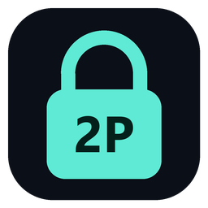
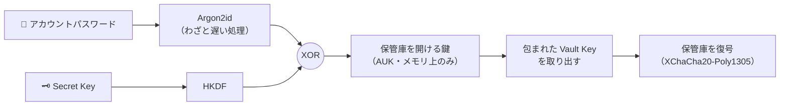
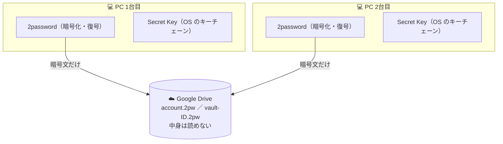

<div align="center">



# 2password

**1Password の安全設計を、自分の手で再現して学べるパスワード保管庫**

パスワードは自分の PC の中で暗号化。Google Drive に置かれるのは「誰にも読めない暗号文」だけ。

### ⬇️ すぐに使う

[](https://github.com/toramon-shield/2password/releases/latest/download/2password-windows-x64-setup.exe)
[](https://github.com/toramon-shield/2password/releases/latest/download/2password-macos-universal.dmg)

<sub>Windows 10 / 11（64bit）・ macOS（Apple シリコン / Intel 共通）｜ [インストール後の使い方](#-インストールと使い方) ・ [すべてのリリース](https://github.com/toramon-shield/2password/releases/latest)</sub>

[](LICENSE)
[](https://www.rust-lang.org/)
[](https://tauri.app/)
[](docs/INSTALL.md)
[](docs/I18N.md)
[](#-セキュリティ)
[](#-toramon-shield-について)

[インストールと使い方](#-インストールと使い方) ・ [特長](#-特長) ・ [しくみ](#-しくみ) ・ [クイックスタート](#-クイックスタート) ・ [コマンド一覧](#-コマンド一覧) ・ [ドキュメント](#-ドキュメント) ・ [FAQ](#-よくある質問)

</div>

---

## 📦 インストールと使い方

プログラミングの知識は要りません。**ダウンロード → インストール → 最初の設定** の3ステップで使い始められます。

### ステップ 1：ダウンロードする

| OS | ダウンロード | 対応環境 |
|---|---|---|
| 🪟 **Windows** | [2password-windows-x64-setup.exe](https://github.com/toramon-shield/2password/releases/latest/download/2password-windows-x64-setup.exe) | Windows 10 / 11（64bit） |
| 🍎 **macOS** | [2password-macos-universal.dmg](https://github.com/toramon-shield/2password/releases/latest/download/2password-macos-universal.dmg) | Apple シリコン / Intel 共通 |

### ステップ 2：インストールする

<details open>
<summary><b>🪟 Windows の場合</b></summary>

1. ダウンロードした `2password-windows-x64-setup.exe` をダブルクリックします。
2. 「Windows によって PC が保護されました」と表示されたら、**詳細情報** → **実行** を押します。
3. 画面の案内に従って **インストール** を押します（管理者権限は不要です）。
4. スタートメニューまたはデスクトップの **2password** から起動します。

</details>

<details>
<summary><b>🍎 Mac の場合</b></summary>

1. ダウンロードした `2password-macos-universal.dmg` をダブルクリックします。
2. 開いた画面で、**2password** のアイコンを **Applications（アプリケーション）** フォルダにドラッグします。
3. 初回だけ、アプリケーションフォルダの 2password を **右クリック（control + クリック）→ 開く** → **開く** を押します。
4. キーチェーンへのアクセス確認が出たら **常に許可** を選びます（Secret Key を Mac のキーチェーンに保存するためです）。

</details>

> [!NOTE]
> 有料の電子署名をしていないため、初回起動時に OS が警告を出します。上の手順で開けます。
> ダウンロードしたファイルが本物かどうかは、[リリースページ](https://github.com/toramon-shield/2password/releases/latest) の `SHA256SUMS.txt` で確かめられます。

### ステップ 3：最初の設定をする

1. アプリを起動して **新しく始める** を押します。
2. **保存先** を選びます。Google ドライブ for デスクトップなどの **同期フォルダ** を指定すると、ほかのパソコンとも共有できます。
3. **アカウントパスワード** を決めます。単語を4〜5個つなげた、長くて自分だけが覚えられるものにしてください。強度のバーが緑になれば使えます。
4. **Secret Key** が表示されます。**Emergency Kit を開いて印刷する** を押し、印刷して施錠できる場所に保管します。

> [!CAUTION]
> アカウントパスワードと Emergency Kit の両方を失くすと、**誰にも復旧できません**（作者にも Google にも中身は読めないためです）。

### 使ってみる

| やりたいこと | 操作 |
|---|---|
| パスワードを登録する | **＋ 追加**。パスワード欄を空にすると、強いパスワードを自動で作ります |
| パスワードを使う | 項目を選んで **コピー**。30秒後にクリップボードから自動で消えます |
| パスワードを見る | **表示**（20秒後に自動で隠れます） |
| 2台目のパソコンで使う | **既存の保管庫に参加** → 同じ保存先を選び、Secret Key とアカウントパスワードを入力 |
| 席を離れる | 右上の **🔒**。5分間操作がないと自動でロックされます |
| 顔・指紋・PIN で解除する | **⚙ 設定 → ロック解除 → Windows Hello（Mac は Touch ID）で解除する** をオンにします（アプリ 0.7.0 以降） |
| PC の起動と同時に使えるようにする | **⚙ 設定 → 自動起動** をオンにします。サインインすると通知領域に常駐し、ブラウザとの接続も自動で行います（アプリ 0.7.0 以降） |
| 保存したパスキーを確かめる・消す | 検索欄の右の **🔑 パスキー** で、パスキーの一覧を出します（アプリ 0.7.0 以降） |

### 🧩 ブラウザで自動入力する（拡張機能）

1Password のように、ログイン画面で呼び出して入力し、ログイン後に保存できます。2 段階認証のコードとパスキーにも対応しています（アプリ 0.4.0 以降）。

1. **拡張機能を入れる**：Chrome で `chrome://extensions` を開き、**デベロッパー モード** をオンにして、**パッケージ化されていない拡張機能を読み込む** からこのリポジトリの [`extension`](extension) フォルダを選びます（Chrome ウェブストア版は準備中です）。
2. **アプリと接続する**：2password アプリの **⚙ 設定 → ブラウザ拡張機能 → ブラウザと接続する** を押し、ブラウザを再起動します。**⚙ 設定 → 自動起動** をオンにすると、接続もまとめて行い、PC を再起動したあともそのまま使えます。
3. **使う**：サイトにログインすると「保存しますか？」と確認します。次回からは、ID やパスワードの欄をクリックすると候補が出ます。
4. **2 段階認証もまとめて通す**：項目の **編集** で、サイトの 2 段階認証の設定キーを登録します。次回からは、項目を 1 回選ぶだけで、ID・パスワードに続いて認証コードも入力されます。
5. **パスキーを使う**：サイトで「パスキーを作成」を押すと、右上に **2password に保存** が出ます。次回からは、2password のパスキーでログインできます。
6. **初回だけ許可する**：取り込んだ項目などをそのサイトで初めて使うときは、アプリが「このサイトでパスワードを使いますか？」と確認します。アドレスを確かめて **許可する** を押すと、そのまま入力されます。
7. **AI エージェントに任せる**：Claude Code や Codex にブラウザを操作させるときは、**⚙ 設定 → ブラウザ拡張機能 → 入力のたびに確認する** をオンにします。エージェントが候補を選ぶたびに、アプリで許可を求めます（[docs/AI_AGENTS.md](docs/AI_AGENTS.md)）。

> [!IMPORTANT]
> **候補が出ないページには、パスワードを入力しないでください。** 候補が出るのは、保存したときと同じアドレスのページだけです。候補が出ないのは「ここは保存したサイトではない」という合図です。

1Password などからの移行は、アプリの **⚙ 設定 → 他のツールから取り込む** で CSV を読み込みます。

👉 くわしくは **[ブラウザ拡張機能の使い方（docs/EXTENSION.md）](docs/EXTENSION.md)**

困ったときの対処など、くわしくは **[インストールと使い方（docs/INSTALL.md）](docs/INSTALL.md)** を参照してください。インストーラーは、このリポジトリのソースコードから GitHub Actions が自動でビルドしたものです。[自分でビルド](#-デスクトップアプリをビルドする) することもできます。

---

## 🐯 Toramon Shield について

**Toramon Shield** は、**「日本の個人情報を守る」** という理念のもと、**AIGYM株式会社** が立ち上げたオープンソースプロジェクトです。

個人情報を守るしくみは、一部の専門家だけのものではなく、誰もが理解し、確かめ、使えるものであるべきだと私たちは考えています。そのため、Toramon Shield のツールはすべてソースコードを公開し、日本語で読めるドキュメントを用意しています。

| プロジェクト | 内容 | 状態 |
|---|---|---|
| **2password**（このリポジトリ） | 1Password の安全設計を再現した、学習用のパスワード保管庫 | 公開中 |
| **toramon-mask** | 個人情報をマスキングするツール | 準備中 |

> [!WARNING]
> 2password は **学習・検証用** のプロジェクトで、第三者によるセキュリティ監査を受けていません。
> 大切なパスワードを預ける前に、この点を理解したうえで使ってください。

---

## ✨ 特長

| | 特長 | 説明 |
|:---:|---|---|
| 🔑 | **鍵を2つに分ける** | アカウントパスワードに加えて、端末にしかない 128bit の **Secret Key** を使います。クラウドの暗号文を盗まれても、総当たりを始めることすらできません |
| 🔒 | **暗号化は端末の中だけ** | Google Drive に送られるのは暗号文だけ。Google にも、作者にも、中身は読めません |
| 🕵️ | **改ざん・差し戻しを検知** | 1バイトの書き換えも、古い版への差し戻しも、ファイルの削除も検知して、端末の控えから復元します |
| ☁️ | **最小限の権限** | Google Drive の権限は「このアプリが作ったファイルだけ」（`drive.file`）。ほかの書類には触れません |
| 🧩 | **ブラウザで自動入力** | Chrome / Edge / Brave の拡張機能が、ログイン画面で候補を出し、ログイン後に「保存しますか？」と確認します |
| 🔢 | **2 段階認証のコードも入力** | 認証アプリと同じ 6 桁のコード（TOTP）を作ります。項目を 1 回選べば、ID・パスワードに続いて認証コードの欄にも入力します。設定キーは拡張機能に渡しません |
| 🗝️ | **パスキーに対応** | パスキーの秘密鍵を保管庫に暗号化して保存し、署名はアプリの中だけで行います。パスキーはサイトに結びつくので、偽サイトでは使えません。保存したパスキーは、アプリの一覧で確かめて外せます |
| 👆 | **Windows Hello / Touch ID で解除** | 顔・指紋・PIN で保管庫を解除できます。アカウントパスワードは、OS の本人確認を通ったときだけ取り出せる鍵で暗号化して端末に置きます |
| 🚀 | **PC の起動と同時に使える** | サインイン時に通知領域に常駐し、ブラウザとの接続も自動で行います。ログイン画面から呼ばれたときは、本人確認だけで解除できます |
| 🎣 | **偽サイトに渡さない** | 保存したときとホスト名が一致するページにしか入力しません。初めてのサイトではアプリで確認し、似た名前の偽サイトでは注意を出します |
| 🤖 | **AI エージェントからも使える** | Claude Code や Codex にブラウザを操作させるときも、候補をクリックするだけでログインできます。パスワードはエージェントに渡さず、入力のたびにアプリで人が許可できます |
| 🌐 | **15 言語で表示** | 日本語・English・简体中文・Español・Português・Français・Italiano・Deutsch・Русский・Türkçe・العربية・हिन्दी・ไทย・Tiếng Việt・Bahasa Melayu。アプリ、拡張機能、コマンドライン、Google ログインの完了ページが、パソコンとブラウザの言語に合わせて切り替わります |
| 📦 | **乗り換えやすい** | 1Password・Chrome・Edge・Bitwarden が書き出した CSV を、そのまま取り込めます |
| 🖥️ | **CLI とデスクトップアプリ** | コマンド `2pw` と、Windows / macOS 用のアプリ（Tauri 2）。暗号のコードは共通です |
| 🎓 | **学べる** | 設計書、図解スライド、攻撃デモ、解説ドキュメントつき。「なぜ安全か」を自分の手で確かめられます |

---

## 🔍 しくみ

### 守りたいもの

パスワード管理サービスでいちばん怖いのは、**保存先（サーバーやクラウド）から保管庫が丸ごと盗まれる** ことです。パスワードだけで守られた保管庫なら、盗んだ人は手元で何億回でもパスワードを試せます。

### 答え：「鍵を2つに分ける」

1Password と同じく、2password は保管庫を開ける鍵を **2つの秘密** から作ります。

| 秘密 | どこにあるか | 特徴 |
|---|---|---|
| 🧠 **アカウントパスワード** | あなたの頭の中 | 自分で決める。覚えられる |
| 🗝️ **Secret Key**（128bit の乱数） | 自分の PC の中と、印刷した紙（Emergency Kit） | 自動で作られる。**クラウドには置かない** |



Google Drive にあるのは暗号文だけで、Secret Key はそこにありません。そのため、Drive から暗号文を盗んでも **総当たりを始めることすらできません**。

### 全体像



もっと詳しい設計と脅威モデルは [設計書](2password-design-and-prompt.md) を、図解は [スライド](2password-handson.html)（ダウンロードしてブラウザで開く）を参照してください。

---

## 🚀 クイックスタート

Google の設定なしで、5分で試せます。

### 1. 必要なものを入れる

| ツール | 用途 | 入れ方 |
|---|---|---|
| **Rust 1.90 以降** | 本体のビルド | https://rustup.rs/ |
| **C/C++ ビルドツール** | Rust が使うリンカーなど | Windows：Visual Studio Build Tools（「C++ によるデスクトップ開発」）<br>macOS：`xcode-select --install` |
| **Git** | ソースの取得 | https://git-scm.com/ |
| Node.js 18 以降 | デスクトップアプリのビルドにだけ必要 | https://nodejs.org/ |

<details>
<summary>💡 Windows で Visual Studio Build Tools を入れたくない場合（管理者権限不要）</summary>

```powershell
rustup toolchain install stable-x86_64-pc-windows-gnu
rustup override set stable-x86_64-pc-windows-gnu
winget install BrechtSanders.WinLibs.POSIX.UCRT --scope user   # dlltool などを入れる
```

</details>

### 2. ビルドする

```sh
git clone https://github.com/toramon-shield/2password.git
cd 2password
cargo build --release -p vault-cli
```

初回は数分かかります。終わると、コマンド `2pw` ができます（Windows：`target\release\2pw.exe`、macOS：`target/release/2pw`）。

以下の例では `2pw` と書きます。実際には `./target/release/2pw`（PowerShell では `.\target\release\2pw.exe`）のように打つか、そのフォルダを PATH に追加してください。

### 3. アカウントを作る

```sh
2pw init --store "$HOME/2pw-vault" --kit "$HOME/emergency-kit.html"
```

（Windows の PowerShell でも macOS のターミナルでも、そのまま使えます）

1. **アカウントパスワード** を2回入力します。単語を4〜5個つなげた、長くて自分だけが覚えられるものにしてください（弱いパスワードは拒否されます）。
2. **Secret Key**（`2P1-XXXXXX-XXXXX-…` の形）が表示され、OS のキーチェーンに保存されます。
3. **Emergency Kit**（印刷用の HTML）が出力されます。印刷して施錠できる場所に保管し、印刷後は HTML ファイルを削除してください。

> [!IMPORTANT]
> アカウントパスワードと Emergency Kit の両方を失くすと、**誰にも復旧できません**。
> アカウントパスワードは Emergency Kit に書き込まず、別に保管してください。

> [!TIP]
> 保管庫と Emergency Kit は、**このリポジトリの外**（上の例ではホームフォルダ）に作ってください。誤ってコミットしないためです。

### 4. 使ってみる

```sh
2pw add "○○銀行" --url https://bank.example -u alice   # パスワードを入力して保存
2pw add "メールアカウント" -u alice -g                  # -g でパスワードを自動生成
2pw list                                               # 一覧
2pw show 銀行 --copy                                   # クリップボードへ（30秒後に消去）
2pw status                                             # 保存先から何が見えているか
```

`2pw-vault` フォルダの `account.2pw` と `vault-<ID>.2pw` をテキストエディタで開いて、項目名もパスワードも読めないことを確かめてみてください。

<details>
<summary>🧪 同じ PC で「2台目の PC」を試す</summary>

環境変数 `TWOPW_HOME` で設定フォルダを切り替えると、別の端末として振る舞います。

```powershell
# Windows（PowerShell）
$env:TWOPW_HOME = "$env:TEMP\2pw-device-b"
2pw join --store "$HOME/2pw-vault"
```

```sh
# macOS（ターミナル）
export TWOPW_HOME=/tmp/2pw-device-b
2pw join --store "$HOME/2pw-vault"
```

Emergency Kit の Secret Key とアカウントパスワードを入力すると、1台目で追加した項目が見えます。終わったら `2pw forget` で「2台目」の設定を消し、`TWOPW_HOME` を元に戻してください（PowerShell：`Remove-Item Env:TWOPW_HOME`、macOS：`unset TWOPW_HOME`）。

</details>

<details>
<summary>⚔️ 攻撃者の視点を体験する</summary>

```sh
2pw attack-demo
```

「Secret Key を知っている攻撃者」と「Drive の暗号文しか持っていない攻撃者」で、パスワード推測の進み方がどう違うかを体験できます。

</details>

<details>
<summary>🧹 後片付け</summary>

```sh
2pw forget   # この端末から設定と Secret Key を消す（保管庫フォルダは残る）
```

保管庫そのものも不要なら、`2pw-vault` フォルダと `emergency-kit.html` を削除してください。

</details>

---

## 📖 コマンド一覧

| コマンド | 内容 |
|---|---|
| `2pw init` | アカウント作成（1台目）。Secret Key を生成して OS のキーチェーンに保存し、Emergency Kit を出力 |
| `2pw join` | 2台目以降の端末で、Secret Key とパスワードを入力して参加 |
| `2pw add <タイトル> [--url URL] [-u ユーザー名] [-g]` | 項目の追加（`-g` でパスワード自動生成） |
| `2pw list` | 一覧 |
| `2pw show <検索語> [--reveal] [--copy]` | 表示。`--copy` は30秒後にクリップボードを消去 |
| `2pw rm <検索語>` | 削除（他の端末にも反映） |
| `2pw totp <検索語> [--set / --clear]` | 2 段階認証のコードを表示（`--set` で設定キーを登録、`--clear` で外す） |
| `2pw passwd` | アカウントパスワードの変更 |
| `2pw gen [長さ]` | パスワードを生成して表示（保存しない） |
| `2pw status` | 保存先から何が見えているかを表示 |
| `2pw attack-demo` | 攻撃者の視点で、Secret Key の有無による違いを体験 |
| `2pw login` / `2pw logout` | Google Drive API 版のログイン／ログアウト |
| `2pw migrate-to-drive` | 同期フォルダ版の保管庫を、暗号文のまま Drive API 版へ移す |
| `2pw forget` | この端末から設定と Secret Key を消す（保存先のデータは残る） |

詳しいオプションは `2pw --help` や `2pw add --help` で確認できます。

---

## ☁️ Google Drive とつなぐ

保存先は2種類から選べます。

| 保存先 | しくみ | 準備 |
|---|---|---|
| **同期フォルダ版**（手軽） | Google ドライブ for デスクトップなど、PC 上のフォルダに暗号文を置く | なし |
| **Google Drive API 版**（おすすめ） | アプリが直接 Google Drive と通信する。権限は `drive.file` だけ | Google Cloud で OAuth クライアントを作る（約15分） |

Drive API 版に切り替える手順は次のとおりです。

1. **Google Cloud で OAuth クライアントを作る** → [手順](docs/course/02-google-oauth-setup.md)
2. ダウンロードした JSON を `oauth-client.json` という名前で、次の場所に置く（このリポジトリの中には置かないでください）

   | OS | 置き場所 |
   |---|---|
   | Windows | `%APPDATA%\2password\oauth-client.json` |
   | macOS | `~/Library/Application Support/2password/oauth-client.json` |

3. Drive 版で始める

   ```sh
   2pw init --drive          # 新しく作る場合
   2pw migrate-to-drive      # 同期フォルダ版から移す場合
   2pw join --drive          # 2台目以降
   ```

   初回はブラウザが開くので、Google アカウントでログインし、「このアプリで使用するファイルのみ」の権限を許可します。

> [!CAUTION]
> `oauth-client.json`（`client_secret_*.json`）は **Git にコミットしない・公開しない** でください。
> このリポジトリの `.gitignore` は、これらのファイル名を除外するよう設定してあります。

---

## 💻 デスクトップアプリをビルドする

GUI は [Tauri 2](https://tauri.app/) で作られており、CLI と同じ Rust コードを使います。

<details open>
<summary><b>方法 A：自分の PC でビルドする（Windows）</b></summary>

```powershell
# Google Drive 版にする場合だけ：OAuth クライアントをアプリに埋め込む
$env:TWOPW_EMBED_OAUTH_CLIENT = "$env:APPDATA\2password\oauth-client.json"

cd app
npx @tauri-apps/cli@2.12.4 build --bundles nsis
# → target\release\bundle\nsis\2password_0.1.0_x64-setup.exe
```

`TWOPW_EMBED_OAUTH_CLIENT` を設定しなければ、同期フォルダ版のアプリになります。

</details>

<details>
<summary><b>方法 B：GitHub Actions でビルドする（Windows / macOS）</b></summary>

Mac を持っていなくても、GitHub 上で `.dmg` を作れます。

1. GitHub の **Actions** タブ → **build-installers** → **Run workflow**（または `v0.1.0` のようなタグを push）
2. 完了後、実行結果ページの **Artifacts** からインストーラーをダウンロード

`v0.1.0` のようなタグを push した場合は、インストーラーを添付した **Release** も自動で作られます。

Google Drive 版を作る場合は、リポジトリの **Settings → Secrets and variables → Actions** に `OAUTH_CLIENT_JSON`（OAuth クライアント JSON の中身）を登録してください。値はリポジトリには保存されず、ビルド時にだけ使われます。

</details>

> [!NOTE]
> デスクトップアプリ用の OAuth クライアントは、インストーラーから取り出せてしまう値です（Google もそう説明しています）。2password は PKCE を必ず併用するので、これだけで保管庫が危険になることはありません。ただし、インストーラーを一般公開すると、他人があなたの OAuth クライアントの利用枠を流用できます。広く配布する場合は配布専用のクライアントを作ってください。

---

## 📚 ドキュメント

| ドキュメント | 内容 |
|---|---|
| 📥 [docs/INSTALL.md](docs/INSTALL.md) | 一般の方向けのインストールと使い方 |
| 🧩 [docs/EXTENSION.md](docs/EXTENSION.md) | ブラウザ拡張機能の入れ方、2 段階認証のコードとパスキーの使い方、1Password などからの移行、しくみと安全性 |
| 🔏 [docs/PRIVACY.md](docs/PRIVACY.md) | プライバシーポリシー |
| 🤖 [docs/AI_AGENTS.md](docs/AI_AGENTS.md) | Claude Code・Codex などの AI エージェントにブラウザを操作させるときの使い方と、`CLAUDE.md`・`AGENTS.md` に書く指示の例 |
| 🌐 [docs/I18N.md](docs/I18N.md) | 表示言語のしくみ（コマンドラインは `TWOPW_LANG` で指定）、翻訳の直し方・言語の足し方 |
| 🔐 [SECURITY.md](SECURITY.md) | 守れること・守れないこと、脆弱性の報告方法 |
| 📐 [2password-design-and-prompt.md](2password-design-and-prompt.md) | 設計書と脅威モデル |
| 🎞️ [2password-handson.html](2password-handson.html) | 図解スライド（ブラウザで開く。暗号化と改ざん検知のライブデモつき） |
| 🔧 [docs/course/02-google-oauth-setup.md](docs/course/02-google-oauth-setup.md) | Google Cloud で OAuth クライアントを作る |
| ☁️ [docs/course/03-drive-api.md](docs/course/03-drive-api.md) | Drive API 版のしくみ（OAuth＋PKCE） |
| 🖥️ [docs/course/04-tauri-gui.md](docs/course/04-tauri-gui.md) | Tauri 2 でのデスクトップアプリ化 |

---

## 🧪 テスト

```sh
cargo test -p vault-core -p vault-client      # 単体テスト
cargo build --release -p vault-cli
bash scripts/e2e.sh /tmp/2pw-e2e              # 2台の端末を模擬した結合テスト（実際の Google Drive には触れない）
```

パスキー、2 段階認証のコード、AI エージェントからの操作は、実際の Chrome（ヘッドレス）で拡張機能のスクリプトを動かして確かめます。パスキーは独立した検証ライブラリ（[@simplewebauthn/server](https://simplewebauthn.dev/)）で、コードは別の実装で計算した値と比べます。Node.js と Chrome が必要です。

```sh
cd scripts/browser-e2e && npm install && npm test
```

`scripts/e2e.sh` は bash で動きます（Windows では Git Bash を使ってください。改ざんテストに Python も使います）。

<details>
<summary>確かめている性質</summary>

**結合テスト**

- 保存先のファイルに、項目名・URL・ユーザー名・パスワードが平文で現れない
- 暗号文の1バイトを書き換えると、復号に失敗する
- 間違ったパスワードを拒否する
- 保管庫を古い版に差し戻されたら検知し、端末の控えから最新版を書き戻す
- 保管庫ファイルを消されても、端末の控えから復元する
- パスワード変更後は、旧パスワードでも旧 `account.2pw` でも開けない
- 削除が他の端末にも反映される
- 拡張機能には、初めてのサイトではアプリでの確認なしにパスワードを返さない
- 同じドメインの別ホスト、似た名前の別サイト、http のページにはパスワードを返さない
- パスキーの登録と署名が、独立した検証ライブラリで正しいと認められる
- 偽サイトが本物のサイト名を名乗っても、パスキーで署名しない。拡張機能には秘密鍵を返さない
- 2 段階認証のコードが RFC 6238 のテスト値と一致する。偽サイトにはコードを返さず、拡張機能には設定キーを返さない
- 「入力のたびに確認する」設定では、許可済みのサイトでも確認する。AI エージェントと同じ操作（DevTools プロトコルのクリック・キー入力、アクセシビリティツリーでの検索）で候補を選べ、パスワードはアクセシビリティツリーに出ない
- コマンドラインの表示と `--help` が、`TWOPW_LANG`・`LANG` の言語で出る

**単体テスト**

- パスワード違い・Secret Key 違い・改ざんを区別せず、同じエラーを返す
- KDF パラメータを弱めたファイルは拒否する
- 鍵導出の結果が、独立実装（Python の argon2-cffi と cryptography）と一致する

</details>

---

## 🗂️ フォルダ構成

```
crates/
  vault-core/     暗号とデータ形式（ファイル I/O なし、unsafe 禁止）
    secret_key.rs   Secret Key の生成・表示形式・入力ゆれの吸収
    kdf.rs          2SKD：NFKC → Argon2id、HKDF(Secret Key)、XOR
    envelope.rs     .2pw 形式：XChaCha20-Poly1305、ヘッダを AAD で認証、4KiB 単位の詰め物
    account.rs      account.2pw：Vault Key を AUK で包む／パスワード変更
    vault.rs        項目モデル、削除の記録（墓石）つきマージ、差し戻し検知用の番号
  vault-client/   保存先（同期フォルダ／Drive API）、キーチェーン、Emergency Kit、同期処理、拡張機能との連絡路、CSV の取り込み
  vault-cli/      2pw コマンドと攻撃デモ
  vault-os-auth/  Windows Hello / Touch ID の本人確認で、解除用の鍵を取り出す（OS の API を呼ぶため、unsafe を使うのはこのクレートだけ）
app/
  src-tauri/      デスクトップアプリの Rust 側（Tauri 2）
  ui/             画面（HTML / CSS / JavaScript）
extension/        ブラウザ拡張機能（Chrome / Edge / Brave、Manifest V3。自動入力とパスキー）
docs/             インストール手順と解説
scripts/e2e.sh    2台の端末を模擬した結合テスト
.github/workflows/installers.yml   Windows / macOS のインストーラーをビルド
```

<details>
<summary>端末に保存されるもの</summary>

| もの | 場所 |
|---|---|
| Secret Key、Google のリフレッシュトークン | OS のキーチェーン（Windows 資格情報マネージャー／macOS キーチェーン） |
| 設定と保管庫の控え（暗号化済み） | Windows：`%APPDATA%\2password`／macOS：`~/Library/Application Support/2password` |
| Windows Hello / Touch ID での解除を有効にしたとき：暗号化したアカウントパスワード | 設定フォルダの `os-unlock.json`。復号の鍵は、Windows では Windows Hello の鍵（TPM など）の署名から毎回作り、macOS ではキーチェーンに置きます |
| 自動起動の登録 | Windows：`HKCU\Software\Microsoft\Windows\CurrentVersion\Run`／macOS：`~/Library/LaunchAgents/dev.twopassword.desktop.plist` |

`TWOPW_HOME` を設定すると、設定フォルダの場所を変えられます。

</details>

---

## 🔐 セキュリティ

> [!WARNING]
> 2password は **学習・検証用** のプロジェクトです。**第三者によるセキュリティ監査を受けていません。** [Apache License 2.0](LICENSE) のとおり無保証で、利用によって生じた損害について開発元は責任を負いません。大切なパスワードを預けるかどうかは、下の表を読んだうえでご自身で判断してください。

| 脅威 | 守れるか | しくみ |
|---|---|---|
| 保存先（Google Drive・同期フォルダ）から暗号文が盗まれる | ✅ | Secret Key がなければ、パスワードの総当たりができません |
| 保存先のファイルの改ざん・古い版への差し戻し・削除 | ✅ | 検知して、端末の控えから復元します |
| アプリに渡す Google の権限が広すぎる | ✅ | 権限を `drive.file`（このアプリが作ったファイルだけ）に限ります |
| 偽サイト（フィッシング）への自動入力 | ✅ | 保存したときとスキーム・ポート・ホスト名が一致するページにしか入力しません |
| 偽サイトに 2 段階認証のコードを渡す | ✅ | コードも、保存したときと同じサイトにしか入力しません |
| 保管庫を開けられたときの 2 段階認証 | ❌ | パスワードと 2 段階認証の設定を同じ保管庫に入れた項目は、保管庫を開けた人が両方を使えます。大切なアカウントは、別の認証アプリやセキュリティキーを使ってください |
| 偽サイトでのパスキーの横取り | ✅ | パスキーは作ったサイトに結びつきます。偽サイトからの求めには署名しません |
| 他人が持つサブドメインへの自動入力 | ✅ | サブドメインには、`*.` と明示した項目しか入力しません |
| 乗っ取られた拡張機能が、パスワードをまとめて引き出す | ⚠️ 被害を限定 | 初めてのサイトではアプリで確認し、要求が続くとロックします。すでに許可したサイトの分は引き出されます |
| 偽サイトに、利用者が手でコピーして貼る | ⚠️ 一部 | 保存済みのサイトに似た名前のページで注意を出します。すべての偽サイトは見つけられません |
| 正規のサイトが改ざんされている | ❌ | 入力した値は、そのページのスクリプトから読めます（どのパスワード管理ツールでも同じです） |
| マルウェアに感染した PC、解除したまま離席した PC | ❌ | 同じ利用者として動くプログラムは、キー入力・画面・メモリを読めます |
| PC ごと盗まれる | ⚠️ | PC には Secret Key があるので、アカウントパスワードの強さだけが頼りになります |

拡張機能の備えのくわしい内容は [docs/EXTENSION.md](docs/EXTENSION.md#偽サイトと拡張機能の乗っ取りへの備え)、報告の方法と対応の目安は [SECURITY.md](SECURITY.md) にあります。

**上限**：アカウントファイルは 64 KiB、保管庫ファイルは 16 MiB までです。同期ツールが作る競合コピーは最大 32 個・合計 64 MiB まで読み込み、マージ後に片付けます。

**脆弱性を見つけたら**：公開の Issue には書かず、GitHub の **Security → Report a vulnerability**（非公開の報告）から知らせてください。

---

## ❓ よくある質問

<details>
<summary><b>アカウントパスワードを忘れました。</b></summary>

Emergency Kit があっても、アカウントパスワードがなければ開けません。2password の作者にも Google にも中身は読めないため、**誰にも復旧できません**。

</details>

<details>
<summary><b>Google のログインが1週間ほどで切れます。</b></summary>

OAuth 同意画面が「テスト中」のためです。Google Cloud で「本番環境」に公開してください（[02-google-oauth-setup.md の手順5](docs/course/02-google-oauth-setup.md)）。

</details>

<details>
<summary><b>「このアプリは確認されていません」と表示されます。</b></summary>

自分で作った OAuth クライアントのため表示されます。自分で作ったものなら **続行** を押して問題ありません。

</details>

<details>
<summary><b>Windows で「PC が保護されました」、Mac で「開発元を検証できません」と出ます。</b></summary>

インストーラーに有料の電子署名をしていないためです。手順は [docs/INSTALL.md](docs/INSTALL.md) を参照してください。

</details>

<details>
<summary><b>スマートフォンで使えますか？</b></summary>

まだです。Tauri 2 のモバイル対応で iOS / Android 版を作るのが次の段階です。

</details>

<details>
<summary><b>本物の 1Password と同じくらい安全ですか？</b></summary>

いいえ。設計の考え方を学ぶための再現で、第三者の監査を受けていません。日常の大切なパスワードには、監査済みの製品を使ってください。

</details>

---

## 📝 用語集

| 用語 | 意味 |
|---|---|
| **Secret Key** | 端末で作る 128bit の乱数。クラウドに置かないので、暗号文を盗まれても総当たりされない |
| **Emergency Kit** | Secret Key を印刷した紙。新しい PC で使い始めるときや、PC を失くしたときに必要 |
| **2SKD** | Two-Secret Key Derivation。パスワードと Secret Key の2つから鍵を作る方式 |
| **AUK** | Account Unlock Key。2SKD で作る鍵。メモリ上にだけ存在する |
| **Vault Key** | 保管庫を実際に暗号化する鍵。AUK で包んで `account.2pw` に保存する |
| **Argon2id** | わざと時間とメモリを使う処理。パスワードの推測を遅くする |
| **XChaCha20-Poly1305** | 認証付き暗号。1バイトでも改ざんされると復号に失敗する |
| **OAuth / PKCE** | Google Drive へのアクセスを許可するしくみ／認可コードの横取りを防ぐしくみ |
| **`drive.file`** | 「このアプリが作ったファイルだけ」に触れる Google Drive の権限 |

---

## 🗺️ ロードマップ

- [x] 暗号コアと CLI（2SKD、`.2pw` 形式、差し戻し検知）
- [x] Google Drive API 版（OAuth＋PKCE、`drive.file`）
- [x] デスクトップアプリ（Windows / macOS）
- [ ] iOS / Android 版
- [x] 生体認証での解除（Windows Hello / Touch ID。デスクトップアプリ）
- [x] 自動起動とブラウザとの自動接続
- [x] ブラウザ拡張機能（自動入力、ログイン後の保存、CSV の取り込み）
- [x] 拡張機能の強化（ホスト名の完全一致、初回の確認、連続要求でのロック、似た名前の警告）
- [ ] Chrome ウェブストアでの公開
- [x] パスキー（サイトと鍵を暗号的に結びつけ、偽サイトでは使えないようにする）
- [ ] パスキーの入力欄の候補方式（Conditional UI）
- [x] 2 段階認証のコード（TOTP）の生成と入力
- [x] 多言語対応（15 言語。アプリ、拡張機能、コマンドライン）
- [x] AI エージェントからの自動入力（入力のたびの確認、許可を待ってからの入力）
- [ ] 共有（HPKE）、漏えいチェック
- [ ] 第三者によるセキュリティレビュー

---

## 🤝 コントリビュート

バグ報告、改善の提案、ドキュメントの修正を歓迎します。

- 🐛 **バグ・要望**：[Issues](https://github.com/toramon-shield/2password/issues) に書いてください
- 🔧 **修正の提案**：Pull Request を送ってください。送る前に `cargo test -p vault-core -p vault-client` と `bash scripts/e2e.sh` が通ることを確認してください
- 🔐 **脆弱性**：公開の Issue ではなく、**Security → Report a vulnerability** から知らせてください

---

## 🙏 参考

- [1Password Security Design White Paper](https://1password.com/files/1Password-White-Paper.pdf)
- [About your Secret Key（1Password）](https://support.1password.com/secret-key-security/)
- [Google Drive API のスコープの選び方](https://developers.google.com/workspace/drive/api/guides/api-specific-auth)

---

## 📄 ライセンス

[Apache License 2.0](LICENSE) で公開しています。

Copyright 2026 AIGYM株式会社（AIGYM Inc.）

「1Password」は AgileBits Inc. の商標です。2password は 1Password とは無関係の、学習目的の非公式プロジェクトです。

<div align="center">

---

**Toramon Shield** — 日本の個人情報を守る

Made with 🦀 by [AIGYM株式会社](https://toramon.ai)

</div>
