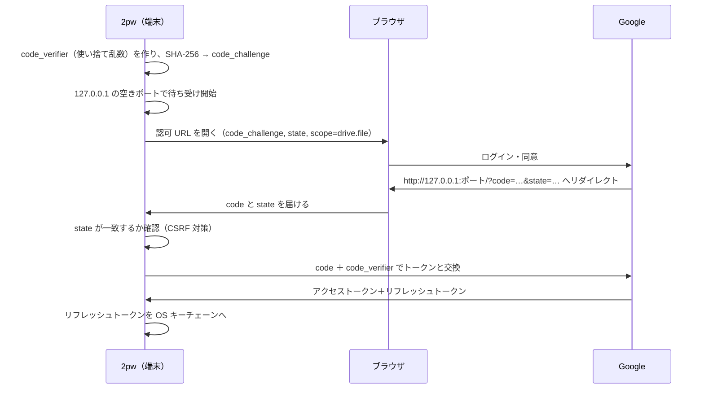

# 保存先を Google Drive API に切り替える

> 所要時間：約25分
> 前提：[02-google-oauth-setup.md](02-google-oauth-setup.md) で作った `oauth-client.json` が所定の場所にあること
> 確認日：2026-11-11（実際の Google Drive で、2台の端末を模擬した動作確認済み）

## この章のゴール

- `2pw` の保存先を「同期フォルダ」から「Google Drive API」に切り替える。
- ブラウザでの Google ログインを、**PKCE** と **ループバック** で安全に実装する。
- 「アプリが作ったファイルだけ」に触れる `drive.file` 権限で、暗号文を読み書きする。

## なぜ同期フォルダから API に切り替えるのか

| | 同期フォルダ版 | Drive API 版 |
|---|---|---|
| 必要なもの | Google ドライブ for デスクトップ | OAuth クライアント ID だけ |
| スマホ対応 | ✕（iPhone/Android には同期フォルダがない） | ◎（同じ API を全 OS から呼べる） |
| アプリが触れる範囲 | マイドライブ全体（同期ソフトの権限） | **このアプリが作ったファイルだけ** |
| 競合 | 同期ソフトが「(1)」付きのコピーを作る | 同名ファイルが複数できたら自動マージ |

最終的に iPhone・Android でも動かすには、API 版が必須です。

## 設計：「保管場所」を差し替えられるようにする

保管場所に求める機能は、たった5つです。

```rust
pub trait Store {
    fn read(&self, name: &str) -> R<Option<Vec<u8>>>;   // 暗号文を読む
    fn write(&self, name: &str, bytes: &[u8]) -> R<()>;  // 暗号文を書く
    fn conflict_copies(&self, vault_id: &str) -> R<Vec<(String, Vec<u8>)>>;
    fn describe(&self, name: &str) -> String;
    fn size(&self, name: &str) -> R<Option<u64>>;
}
```

**保管場所は暗号文のバイト列を出し入れするだけで、中身を知りません。** だから同期フォルダでも Drive API でも、暗号・差し戻し検知・マージの処理はまったく同じコードで動きます。

## ログインの仕組み（`drive.rs` の `login`）



### 安全のための工夫

| 工夫 | 防ぐもの |
|---|---|
| **OS 標準のブラウザ**で開く（アプリ内の埋め込み画面を使わない） | 偽のログイン画面。Google も埋め込み画面を禁止している |
| **PKCE**（code_verifier / code_challenge） | 認可コードの横取り。横取りされても verifier がないとトークンにできない |
| **state** の照合（定数時間比較） | 別のサイトから偽の応答を送り込む攻撃（CSRF） |
| **127.0.0.1** の空きポート | 外部から待ち受けポートに接続されること |
| 付与されたスコープの確認 | 同意画面で Drive のチェックを外された場合を検知して止める |
| リフレッシュトークンは **OS キーチェーン**、アクセストークンは **メモリのみ** | ディスクにトークンが平文で残ること |
| `https_only(true)`、TLS は **rustls**（OpenSSL 不使用） | 平文通信、OpenSSL 由来の脆弱性 |

## Drive への読み書き

| 操作 | API |
|---|---|
| フォルダを探す | `GET /drive/v3/files?q=name='2password-vault' and mimeType='application/vnd.google-apps.folder'` |
| フォルダを作る | `POST /drive/v3/files`（`mimeType` をフォルダに） |
| ファイルを探す | `GET /drive/v3/files?q=name='…' and '<フォルダID>' in parents` |
| ダウンロード | `GET /drive/v3/files/<ID>?alt=media` |
| 新規アップロード | `POST /upload/drive/v3/files?uploadType=multipart` |
| 上書き | `PATCH /upload/drive/v3/files/<ID>?uploadType=media`（Drive に版の履歴が残る） |

`drive.file` 権限では、**このアプリが作ったファイルしか検索結果に出てきません**。マイドライブにある他の書類は、アプリからは存在すら見えません。

## ハンズオン

### 1. ログインする

```powershell
2pw login
```

ブラウザが開くので、[02-google-oauth-setup.md](02-google-oauth-setup.md) でテストユーザーに追加したアカウントでログインします。

- 「Google はこのアプリを確認していません」と出たら、**続行**（テスト中のアプリなので正常です）。
- 権限の画面では、Google ドライブのチェックを**外さない**。

ターミナルに「✓ Google にログインしました」と出れば完了です。

### 2a. 新しく始める場合

```powershell
2pw init --drive
```

### 2b. 同期フォルダ版から移す場合

```powershell
2pw migrate-to-drive
```

暗号文のまま移すだけなので、パスワードも Secret Key も変わりません。

### 3. 2台目の端末

```powershell
2pw join --drive
```

Emergency Kit の Secret Key とアカウントパスワードを入力します。2台目でも、初回は Google へのログインを求められます。

> 💡 同じ PC で2台目を試すには、`$env:TWOPW_HOME = "$env:TEMP\2pw-device-b"` のように設定フォルダを分けます。Google のログインは OS ユーザーごとに1回なので、同じ PC なら共有されます。

### 4. Drive 側から見てみる

```powershell
2pw status
```

ブラウザで Google Drive を開き、`2password-vault` フォルダの中身を確認します。`account.2pw` と `vault-<ID>.2pw` があり、ダウンロードして開いても意味のあるデータは何も読めません。

## よくあるつまずき

| 症状 | 原因と対処 |
|---|---|
| `OAuth クライアントの設定ファイルがありません` | `oauth-client.json` の置き場所を確認（[02-google-oauth-setup.md](02-google-oauth-setup.md) の手順4） |
| `種類が「ウェブ アプリケーション」です` | クライアントの種類を「デスクトップ アプリ」で作り直す |
| `403 accessNotConfigured` | Google Drive API を有効にしていない（[02-google-oauth-setup.md](02-google-oauth-setup.md) の手順2） |
| `access_denied` / テストユーザーではない | 同意画面のテストユーザーに自分のアカウントを追加する |
| `Google Drive へのアクセスが許可されませんでした` | 同意画面で Drive のチェックを外した。`2pw login` をやり直す |
| 1週間後に `invalid_grant` | テスト中のアプリはトークンが7日で失効。`2pw login`、または本番環境に公開 |

## 確認チェックリスト

- [ ] `2pw login` でブラウザが開き、ログインできた
- [ ] 権限が「このアプリで使用するファイルのみ」だった
- [ ] `2pw init --drive`（または `migrate-to-drive`）で、Drive に `2password-vault` フォルダができた
- [ ] 2台目で `join --drive` し、同じ項目が見えた
- [ ] Drive からダウンロードしたファイルを開いても中身が読めなかった

## 確認クイズ

1. 認可コードを横取りされても、トークンに交換されないのはなぜか。
   → **PKCE。** 交換には端末だけが知っている code_verifier が必要だから。
2. `state` を照合しないと、どんな攻撃が成立しうるか。
   → **CSRF。** 攻撃者が用意した認可結果を、利用者の端末に受け取らせることができてしまう。
3. `drive.file` 権限のアプリから、マイドライブにある請求書の PDF は見えるか。
   → **見えない。** アプリが作った・開いたファイルだけが対象。
4. 同期フォルダ版から Drive API 版に移したとき、Secret Key は変わるか。
   → **変わらない。** 暗号文をそのまま移しているだけで、鍵は端末の中にある。

## 実装メモ

- 2台が同時に「新規作成」すると、Drive に同名ファイルが2つできることがある。`conflict_copies` が2つ目以降を返し、項目単位でマージする。
- 同時に上書きした場合は「後から書いた方」が残るが、次に開いた端末が自分の控え（端末内の暗号文コピー）と差し戻し検知で整合を取る。厳密な排他制御（ETag / `headRevisionId` による条件付き更新）は今後の改善点。
- テスト用に `TWOPW_DRIVE_FOLDER=2password-vault-test` で Drive 上のフォルダ名を変えられる。
- Windows で Visual Studio Build Tools がない場合、reqwest の既定の暗号プロバイダ（aws-lc-rs）はビルドに追加のツールが要るため、`rustls-no-provider` ＋ `ring` を使っている。

## 次の章

[04-tauri-gui.md](04-tauri-gui.md) では、Tauri 2 で GUI アプリにします（Windows / macOS）。CLI で作った `vault-core` と `Store` をそのまま使います。
